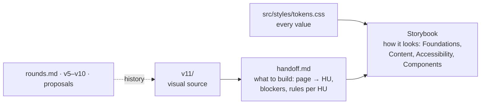

# Design

Everything about how the site looks and behaves: the direction, every iteration, and the prototypes themselves. **v11 is the current prototype, sealed 2026-10-28.** Final copy and the production Astro build are pending.

## Where things live



| Need                                     | Go to                                                         |
| ---------------------------------------- | ------------------------------------------------------------- |
| Tokens, type, color, motion, a11y rules  | Storybook: `npm run storybook` (source in `.storybook/docs/`) |
| What each HU builds and what blocks it   | [handoff.md](handoff.md)                                      |
| What the site looks like                 | [v11/](v11/index.html)                                        |
| What was decided, and what it replaced   | [decisions log](../decisions-log.md)                          |
| The copy and screen plan of the projects | [Project content](../content/projects/README.md)              |

## History

| Document                                                                                                                                         | Answers                                                               |
| ------------------------------------------------------------------------------------------------------------------------------------------------ | --------------------------------------------------------------------- |
| [workflow.md](workflow.md)                                                                                                                       | How the design was made with AI: steps, artifacts and rules           |
| [principles.md](principles.md)                                                                                                                   | The original rules and tokens (now in Storybook and `tokens.css`)     |
| [references.md](references.md)                                                                                                                   | Which sites inspire us and what we take from each                     |
| [rounds.md](rounds.md)                                                                                                                           | Every round: what was proposed, the owner's feedback, what we learned |
| [v6](v6-proposal.md), [v7](v7-proposal.md), [v8](v8-proposal.md), [v9](v9-proposal.md), [v10](v10-proposal.md), [v11](v11-proposal.md) proposals | Scope, implementation and verification of each prototype version      |

Rounds 1–4 were built as Claude artifacts; their links in [rounds.md](rounds.md) are kept as provenance. From v5 on, the HTML in this folder is the only review source.

## Prototype versions

| Version | Source                                          | Role                                                                                                                                                | Built by               |
| ------- | ----------------------------------------------- | --------------------------------------------------------------------------------------------------------------------------------------------------- | ---------------------- |
| v5      | [v5/](v5/index.html)                            | Owner-supplied baseline (exact export)                                                                                                              | Claude / owner         |
| v6      | [v6/](v6/index.html)                            | JOTA signature in the card, dedicated case URLs                                                                                                     | Codex                  |
| v7      | [v7/](v7/index.html)                            | Immersive Home, card-first mobile, pannable desk                                                                                                    | Codex                  |
| v8      | [v8/](v8/index.html)                            | Direct scroll/pan on desktop Home, compact mobile exploration                                                                                       | Codex                  |
| v9      | [v9/](v9/work/mercado-libre-lists/index.html)   | Approved project content; Mercado Libre case as the template for every case                                                                         | Claude (review: Codex) |
| v11     | [v11/](v11/index.html)                          | **Current, sealed 2026-10-28:** v10 plus Home board adjustments (one grid, no zoom, hint pill, drag-only hand-off), no Home notes, shared back pill | Claude                 |
| v10     | [v10/](v10/work/mercado-libre-lists/index.html) | Sealed: case page from the owner's review; recreated components; [Spanish](v10/es/work/mercado-libre-lists/index.html)                              | Claude (review: Codex) |

Shared photos live in [assets/](assets/). The prototypes sit outside Astro's `public/`, so they are never deployed.

## Review locally

From the repository root:

```sh
python3 -m http.server 4326 --bind 0.0.0.0 --directory docs
```

Open [http://127.0.0.1:4326/design/](http://127.0.0.1:4326/design/) for the history index, or `/design/v11/` for the current prototype (case template: `/design/v11/work/mercado-libre-lists/`). On a phone on the same Wi-Fi, replace `127.0.0.1` with the Mac's address (`ipconfig getifaddr en0`).

## Rules for a new version

1. Create a new folder (`v9/`); never edit an earlier version. Compare versions by opening their URLs.
2. Record its file hashes in `history/v9.json` and add it to `scripts/verify-design-history.mjs`.
3. Write `v9-proposal.md` and add a round to [rounds.md](rounds.md).
4. Run `node scripts/verify-design-history.mjs`: every earlier version must still match.

Prettier and ESLint skip the prototype folders so frozen files are never rewritten. Sample cases, notes, dates and roadmap milestones in the prototypes are provisional, not publication content.
