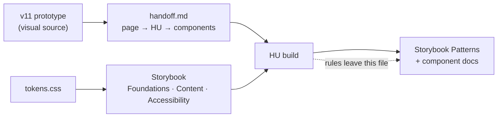

# Design handoff

**Spike:** `SP-01-design-handoff`, 2026-10-29, scope extended 2026-10-30. **Question:** can HU-01 be planned from the documentation alone, without reading the design rounds?

This file is for **planning**: it maps the sealed prototype to the backlog, lists what blocks each HU and holds the design rules each HU must respect until its Patterns page exists. How the design **looks** (tokens, type, color, motion, content and accessibility rules) lives in Storybook (`npm run storybook`), read live from `src/styles/tokens.css`. The visual source is the sealed prototype [`v11/`](v11/index.html); when a rule here and v11 disagree, v11 wins and this file is corrected.

## Handoff map

Paths in the v11 column are relative to `docs/design/v11/`. Components marked _shared_ are built once, in the first HU that needs them, and reused.

| v11 page                        | v11 source                                                                                | HU    | Components                                                                                                                                                                                                                                                                                                                       | Content source                                               |
| ------------------------------- | ----------------------------------------------------------------------------------------- | ----- | -------------------------------------------------------------------------------------------------------------------------------------------------------------------------------------------------------------------------------------------------------------------------------------------------------------------------------- | ------------------------------------------------------------ |
| Home · card, dock, footer       | `index.html`, `styles.css`                                                                | HU-01 | Base layout, JOTA mark, IdentityCard, CareerPath, Button _shared_, Dock _shared_, ThemeToggle, CopyEmail _shared_, Footer _shared_, LanguageSwitch _shared_, SkipLink                                                                                                                                                            | Card copy in `index.html` (draft); career path from the card |
| Home · desk                     | `app.js` (objects), `experience.js`, `canvas.js`                                          | HU-02 | Desk (camera, drag), DeskObject (flip, keyboard move), HintPill, ExploreDialog (mobile), compact card                                                                                                                                                                                                                            | Object copy in `app.js` (samples)                            |
| Work                            | `index.html#work`, `app.js` (`WORK`)                                                      | HU-03 | WorkList, WorkRow, WorkPreview, status tag                                                                                                                                                                                                                                                                                       | `docs/content/projects/*.md` (titles, summaries)             |
| Case · Pragma (brand-platforms) | `work/brand-platforms/`, `es/…`, `learned/`, `nosotras.*`, `pragma-intro-b.css`, `case.*` | HU-04 | BackPill _shared_, CaseHeader, FactsStrip, LearnedIntro (media right), SeeWhatWeBuilt, Chapter, FullStory disclosure, ExampleFrame, BrowserFrame, PhoneFrame _shared_, LivePreview, Flow, Video with captions, Petys/TENA/Nosotras playgrounds, CaseNext; `<Context>`, `<Role>`, `<Decision>`, `<Metric>`, `<Figure>`, `<Stack>` | `pragma-brand-platforms.md`                                  |
| Case · Bancolombia              | `work/bancolombia-svp/` (v9 pattern)                                                      | HU-05 | Case foundation; micro-frontends diagram                                                                                                                                                                                                                                                                                         | `bancolombia-sucursal-virtual-personas.md`                   |
| Case · Mercado Libre            | `work/mercado-libre-lists/`, `es/…`, `learned/`, `intro-c.css`                            | HU-06 | Lists recreation (desktop dialog, mobile sheet), coverage card, Gherkin runner, navigation simulation                                                                                                                                                                                                                            | `mercado-libre-favorites-gift-lists.md`                      |
| Case · GoodRx                   | `work/goodrx-observability/` (v9 pattern)                                                 | HU-07 | Case foundation; figures and cards                                                                                                                                                                                                                                                                                               | `goodrx-groundcover-migration-redesign.md`                   |
| Case · CAPS+                    | `work/caps-plus/`                                                                         | HU-08 | Status layout                                                                                                                                                                                                                                                                                                                    | `caps-migration.md`                                          |
| Notes hub and note              | `index.html` views `v-notes`, `v-note`; `app.js`                                          | HU-09 | NotesIndex (by year), NotePage, note actions (LinkedIn, copy link), BackPill                                                                                                                                                                                                                                                     | `src/content/articles/` (empty; owner writes)                |
| Roadmap, letter, More about me  | views `v-roadmap`, `v-letter`; `app.js`                                                   | HU-10 | Timeline, Letter, back control (decision)                                                                                                                                                                                                                                                                                        | Samples in `app.js`; `src/content/pages/*/more-about-me.md`  |
| 404                             | not designed                                                                              | HU-12 | Designed first in `docs/design/v12/`                                                                                                                                                                                                                                                                                             | —                                                            |

HU-11 (SEO), HU-13 (audits) and HU-14 (launch) have no v11 page.

## Design rules by HU

The rules from the prototype that each HU must respect. When the HU closes, its rules move to a Storybook Patterns page (or the component's docs) and leave this file. Patterns pages start once Home (HU-01 and HU-02) is built.

### HU-01 · Home foundation

- **Hierarchy:** identity card, then personal objects, then dock. On desktop the board fills the first screen; Work is one click away, not visible on arrival.
- **Identity card:** JOTA mark, name (H1), role, one sentence, Get in touch (primary) and Download CV (ghost), LinkedIn · GitHub · More about me, career path (company, role, years).
- **Buttons:** primary (`--color-accent`, `--color-on-accent`) for the single most important action in its area; ghost (border, text color) for secondary actions and every link that leaves the site. Labels 15px/500 (14px for `sm`). Targets ≥ 44px tall; pills and the back control 48px.
- **Dock** (floating, bottom center, `--color-surface` at 92% with blur): Home, Work, Notes · separator · Copy email, Theme. No Roadmap entry (the rocket object reaches it); a variant with Roadmap is kept, and the owner chooses when the layout is implemented in HU-01. Dock radius 18px (local value). Not shown on case pages.
- **Footer:** Site, Social and Contact columns, copy-email button, CV link, large wordmark, "Hecho en Madrid, con raíces colombianas" with the flag detail.
- **Language switch:** EN · ES, 44px target. English at `/`, Spanish under `/es/`. Its place on Home is designed first in `v12/` inside HU-01, starting from the case-page switch.
- **Skip link** to projects as the first focusable element.
- **No Notes section on Home** (v11).

### HU-02 · Home board

- **Desk (≥ 901px):** ten objects (moto, teaching, envelope/letter, rocket/roadmap, ticket, portrait, vinyl, Naruto, LoL, pole). Background drag pans; object drag moves it; Enter flips; M plus arrows moves by keyboard; Tab brings each object into view; `0`/Home recenters. One dot grid that moves with the camera. No zoom, Recenter or See all. Objects never settle on the card (protected zone).
- **Hint pill:** "Drag to explore" above the dock, short bounce. At the bottom edge it arms ("Keep dragging for Work ↓"); only a held drag fills it (2.6s) and opens Work; releasing cancels; wheel and trackpad never open Work.
- **Mobile (≤ 900px):** the full identity card first; More about me opens the desk in a dialog with a compact card (JOTA, name, role), floating Close, objects around it; the page still scrolls normally.

### HU-03 · Work

- Editorial heading "Selected projects", company label, larger project title, short summary, a substantial sticky preview on desktop, thumbnails on touch. No 01–05 numbers.
- Cases not built yet show as "coming" with no link. Each case has its own URL; the title shares a View Transition name with the case header.

### HU-04 to HU-08 · Case pages

- **Back pill** (one definition for cases, Notes index and note pages): 48px, chevron disc on `--color-bg-subtle`, label plus mono caption ("All work · Selected projects"), sticky top left, hairline under it once the page scrolls, `view-transition-name: case-back`. Returns to the exact row the reader came from, focused.
- **Header:** company label, title, "See it live" (ghost, with a visible note such as "Sign-in required" when needed), then a labeled Role · Period · Stack strip. EN · ES switch top right.
- **Intro, primary:** "What I learned" with media on the right (photo or video), text and quote on the left, a floating "See what we built" button (bottom center, gentle bounce, fades out on scroll and becomes unfocusable, smooth-scrolls to chapter 01). **Secondary, tentative:** the plain chapter in `learned/`; the owner picks while building each case.
- **Chapters:** number, title, one lead sentence, the interactive piece, then **"The full story"** disclosure holding the approved paragraphs unchanged.
- **Examples / playgrounds:** one frame for all: mono uppercase label top left ("… · not <company> code"), controls top right (Before/After, Desktop/Mobile, Reset), hint bottom left. **Foot rule (2026-10-28):** the violet primary is only the action that runs the demo and is always rightmost; leaving links are ghost, to its left. Every interactive piece has a scripted path (Play, Run scenario, Show me).
- **Widths:** visuals inside cases up to 1040–1120px; prose keeps `--measure-prose`.
- **Device frames:** a browser frame and one iPhone frame shared by every case (402×874pt scaled).
- **Live previews (brand sites):** cached capture at rest; on click a View Transition expands it and the iframe loads only then, when the site's framing policy allows it; "Open site ↗" always available.
- **End:** next case and All work, then the footer. No dock; the footer carries contact and copy-email.

### HU-09 · Notes

- Hub grouped by year; note page with date, body, "Discuss on LinkedIn" and "Copy link"; both use the back pill ("All notes · Written along the way", "Home · Portfolio"). No sample note is ever published.

### HU-10 · Roadmap, letter, More about me

- Roadmap and Letter still use a text "← Home" link; whether they adopt the back pill is decided in this HU.
- Caveat is used for the letter greeting.
- Prototype notes, roadmap milestones and letter text are samples, never publication content.

## Blockers by HU

What must exist before an HU can **close**. None of these block **planning** HU-01.

| HU    | Blocker                                                                                                                                      | Who            |
| ----- | -------------------------------------------------------------------------------------------------------------------------------------------- | -------------- |
| HU-01 | Final card sentence and role line (the card shows the draft "I build products with care…"; the brief keeps another headline)                 | Owner          |
| HU-01 | Spanish copy for card, dock, footer                                                                                                          | Owner approves |
| HU-01 | CV file (PDF, EN and ES?)                                                                                                                    | Owner          |
| HU-01 | Instagram and TikTok URLs in the footer (`data-todo` in v11), or drop them                                                                   | Owner          |
| HU-01 | Portrait/foundation photo consent                                                                                                            | Owner          |
| HU-02 | Final object copy (vinyl, Naruto, LoL, pole label); pole vs. aerial silks wording                                                            | Owner          |
| HU-04 | PRAGMA's OK to self-host the reel; video ≤ 8 MB with ES/EN captions and transcript; Personajes XD exports; framing policy of each brand site | Owner · build  |
| HU-05 | Bancolombia team-photo permission                                                                                                            | Owner          |
| HU-06 | Replace or clear third-party product photos in `assets/meli-ui/`; ML team-photo permission; "See it live" URL and country                    | Owner          |
| HU-08 | CAPS+ client clearance (stays "Under construction" until then)                                                                               | Owner          |
| HU-09 | At least one real note per language                                                                                                          | Owner          |
| HU-10 | 10 `TODO(verify)` in More about me; letter text; Staff-level goals for the roadmap                                                           | Owner          |
| HU-11 | Not a blocker: OG images move to Onest and `@fontsource/inter` is removed (kept until then, owner 2026-10-30)                                | Build          |
| HU-14 | Domain, Cloudflare Pages production project                                                                                                  | Owner          |

## Decided for HU-01 (owner, 2026-10-30)

1. **Dock contents.** Both variants stay: v11 (Home, Work, Notes, copy email, theme) and one with Roadmap. The owner chooses when the layout is implemented.
2. **Language switch on Home.** A small v12 design item inside HU-01, starting from the case-page switch (backlog rule: anything not designed is designed first in `v12/`).
3. **Draft scales.** They stay Draft; HU-01 freezes them by comparing the built Home against v11 in the browser. v11 uses values off the Draft grid: spacing 6, 10, 14, 18, 22, 28 and 36px (10px is the most used); radii 10px (tooltip), 14px (desk objects) and 18px (main card, dock, preview); durations 180ms (the most used), 220ms and 350ms against the Draft's 200/300/500ms. Each is either snapped to the scale or added to it.

## Recommendation

**Ready** (owner, 2026-10-30). HU-01 can be planned from Storybook, this file and `v11/` without reading the rounds. The decisions above are settled inside HU-01; the remaining blockers are owner inputs needed to close HU-01, not to plan it.
