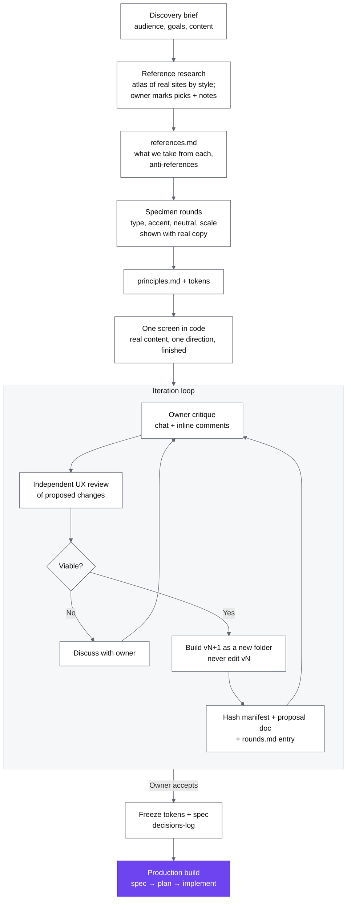

# Design workflow

How the design was made with AI. The owner directs and decides; AI agents (Claude, Codex) build, review and explain. Design happens in code, in the browser, with no Figma. Everything the process produced is in this folder, so any agent or reader can follow the trail.

## Overview

## Steps and artifacts

| Step           | Artifact                                                             | Notes                                                                                                                               |
| -------------- | -------------------------------------------------------------------- | ----------------------------------------------------------------------------------------------------------------------------------- |
| References     | [references.md](references.md)                                       | Real sites, grouped by style; the owner's verdicts drive it. Asking for "something distinctive" from scratch regresses to the mean. |
| Specimen       | [rounds.md](rounds.md) entry + [principles.md](principles.md) tokens | Vivid accents need a separate, darker text tone; legibility comes first.                                                            |
| Screen in code | `vN/`                                                                | Real content, never placeholder filler. One polished direction, not several half-baked ones. Do not design around a metaphor.       |
| Review         | [rounds.md](rounds.md) entry                                         | Owner feedback is quoted; the independent UX review is recorded with what changed because of it.                                    |
| Version        | `vN/`, `history/vN.json`, `vN-proposal.md`                           | Byte-identical history checked by a script; versions are compared by URL.                                                           |
| Accept         | [decisions-log](../decisions-log.md)                                 | Then the production spec and plan.                                                                                                  |

## Rules

- **Never overwrite.** Each iteration is a new version folder; earlier ones stay reviewable.
- **Prototypes are not shipped.** They live outside the deployable directory (`docs/design/`, not Astro's `public/`) and are served locally with a static server.
- **The repo is the single review source.** Hosted artifacts (claude.ai) are provenance only, never a competing current version. Any agent can build the next version from the repo.
- **Every round is recorded:** proposed → owner feedback → learned.
- **Viability before effort.** If a requested change will not work, the agent says so, with alternatives, before building.
- **Private material.** Personal photos and screenshots: blur plates, crop names, addresses and account data; third-party brands appear as text unless credited.
- **Teach while doing.** Agents briefly explain the why of each design choice so the owner builds taste and vocabulary.

## How the rounds happened

| Round    | Dates         | What                               | Outcome                         |
| -------- | ------------- | ---------------------------------- | ------------------------------- |
| 1        | Sep 25        | Three static directions            | Rejected: looks AI-made         |
| 2        | Sep 28        | Three animated prototypes          | Rejected: metaphor over content |
| Research | Sep 28–Oct 22 | Atlas of 64 portfolios             | 3 primary references            |
| 3        | Oct 22        | Specimen v1–v2                     | Violet, Onest, compact scale    |
| 4–5      | Oct 22–23     | Home board v3–v5                   | Locked card, dock, footer       |
| 6–8      | Oct 23–25     | Codex v6–v8 in the repo            | v8 accepted                     |
| 9–11     | Oct 26–28     | Case template and Home adjustments | v11 sealed                      |

Full detail of each round, including the owner's quoted feedback, is in [rounds.md](rounds.md). The first two rounds failed for a process reason, not a visual one: the agent produced "distinctive" work from scratch, shown half-finished. The fix was the flow above: references chosen by the owner first, then one screen finished properly.
