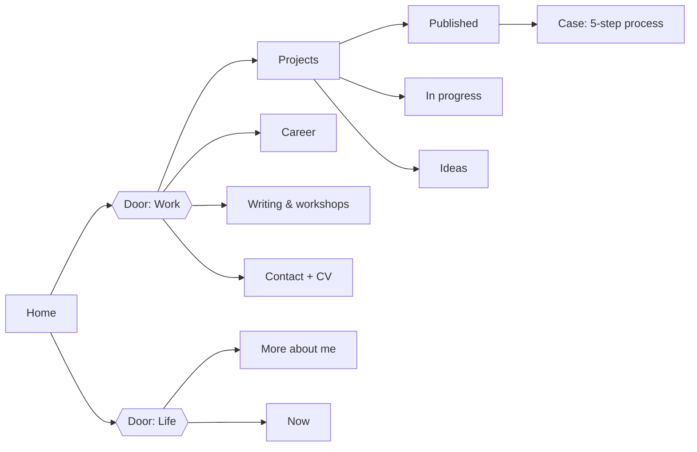

# Discovery Brief — jouler-talaigua.dev

- **Status:** Final (closes Epic 1)
- **Date:** 2026-09-25
- **Owner:** Jouler Talaigua · **Project lead:** Claude
- **Inputs:** CV, Jouler's brand note (Obsidian), Notion project plan (epics 1–9)
- **Working copy (Spanish, with review comments):** Claude Docs — "jouler.dev — Brief de Discovery v1"

## Decisions

| Topic               | Decision                                                                                                                                                                                                                             |
| ------------------- | ------------------------------------------------------------------------------------------------------------------------------------------------------------------------------------------------------------------------------------ |
| Positioning         | Senior full-stack **product engineer** with deep frontend expertise. The stack is shown by depth (expert / shipped with / learning) so it reads complete without overstating. Staff Engineer is the growth direction, not the title. |
| Default language    | English at `/`, Spanish at `/es/`                                                                                                                                                                                                    |
| Domain              | `jouler-talaigua.dev` or `.com`, depending on availability (owner buys it)                                                                                                                                                           |
| Home headline       | _Senior full-stack engineer. I ship products, shape frontend architecture, and teach what I learn._                                                                                                                                  |
| Trajectory line     | "From QA to Tech Lead" on Career (where I come from); "From QA to Staff Engineer" on Now (where I'm going)                                                                                                                           |
| Mercado Libre       | Team: Home & Search; my initiative: Gift & Registry. Public screenshots of the redesign and the prize roulette are OK. No internal metrics.                                                                                          |
| Bancolombia         | Team: SVP. Public source: Jouler's LinkedIn post, cleared by his product lead and the Bancolombia manager.                                                                                                                           |
| "More about me"     | Short page at launch; grows later                                                                                                                                                                                                    |
| Placeholder content | Cases and articles start as realistic drafts; every invented fact is marked `TODO(verify)` and the build fails in production while any remain                                                                                        |
| Client-side JS      | Site chrome (theme, language, nav) is vanilla; React only for genuinely interactive pieces                                                                                                                                           |
| Framework           | Astro 7 — see [ADR 001](adr/001-stack.md)                                                                                                                                                                                            |

## Audience

The site speaks first to whoever decides on hiring. Life and interests are the second door, not an appendix.

| Audience                                  | What they look for in 60 seconds          | What we give them                                      |
| ----------------------------------------- | ----------------------------------------- | ------------------------------------------------------ |
| European recruiter / hiring manager (B2B) | Seniority, stack, availability, time zone | Clear headline, 2 featured cases, CV download, contact |
| Tech lead evaluating judgment             | How decisions and trade-offs are made     | Cases with full process, ADRs, articles                |
| Community, students, universities         | Talks, workshops, teaching style          | Articles & workshops, talks                            |
| Like-minded people                        | Who Jouler is outside work                | More about me: coffee, football, aerial silks, travel  |

How Jouler wants to be recognized, and where the site proves it:

- **Does things as well as possible** → the site itself (Lighthouse 100, public ADRs) and the case studies.
- **Loves teaching, learning and experimenting** → SENA, talks, articles, "in progress" and "idea" projects.
- **Communication and leadership** → the QA-to-Tech-Lead story, mentoring and onboarding at PRAGMA, a ~20-engineer team across 4 countries at Mercado Libre.

## Brand

- **Jouler Talaigua** — public name: title, domain, SEO, CV.
- **JOTA** — the visual signature: monogram, favicon, OG images, and the byline on projects and notes ("JOTA · Projects", "JOTA · Notes"). It never replaces the name.
- **Tone:** first person, direct, technical without marketing jargon. Real numbers when shareable; nothing inflated.

## Sitemap

Two doors — **Work** and **Life** — from the home page. Main nav: Projects · Career · Writing · More about me · Contact.

| Page                | Goal                                                                               |
| ------------------- | ---------------------------------------------------------------------------------- |
| Home                | Who I am, what I bring, two concrete proofs, and the two doors                     |
| Projects            | What I build, by status: published, in progress, ideas. "Open source" filter       |
| Project case        | Ideation → experimentation → design → implementation → results                     |
| Career              | From QA to Tech Lead: background, skills, teaching and talks                       |
| Writing & workshops | First-hand experience: architecture, migrations, testing, design systems, teaching |
| More about me       | Coffee, football, aerial silks, travel, learning — in Jouler's own voice           |
| Now                 | Current focus and learning roadmap; "From QA to Staff Engineer" (build in public)  |
| Contact             | Email, LinkedIn, GitHub, CV download; also in every page footer                    |

"Process" is not a separate page: it is the structure of every case study, which is where a reviewer sees judgment in action.

## Content

### Initial projects

| Project                                        | Status      | Type                   | What we can show                                        |
| ---------------------------------------------- | ----------- | ---------------------- | ------------------------------------------------------- |
| Mercado Libre — Gift & Registry (Favorites)    | Published   | Professional case      | Public redesign screenshots; test coverage story        |
| Mercado Libre — Prize roulette (Brazil)        | Published   | Professional case      | First gamification game; public screenshots; SSR + BFF  |
| Bancolombia — micro frontends (PRAGMA, SVP)    | Published   | Professional case      | Module Federation + Clean Architecture; LinkedIn post   |
| CAPS+ — .NET to React migration                | In progress | Professional case      | Pending Cast & Crew clearance                           |
| EKOU Personal Nexus                            | In progress | Own project, with code | Transaction-driven finance app with an AI capture layer |
| jouler-talaigua.dev                            | In progress | Own project, with code | This site, its ADRs and metrics                         |
| Ideas (EKOU Academy, Nexus Frontend Platform…) | Idea        | Own project            | Short note: problem and hypothesis                      |

### Case study template

1. **Context & problem** — who used it and what hurt.
2. **My role** — what was mine vs. the team's, without inflating.
3. **Ideation & experimentation** — options considered, spikes, what was discarded.
4. **Design & decisions** — architecture and trade-offs, with a diagram.
5. **Implementation** — stack and what was hard.
6. **Results & learnings** — shareable numbers and what I'd do differently.

**Implementation requirement — "lego" content.** Cases and articles are MDX (Markdown + components). Each template step has its own component (`<Context>`, `<Role>`, `<Decision>`, `<Metric>`, `<Figure>`, `<Stack>`…), documented in a content README so any agent can assemble a new case or article without touching code. Jouler refines drafts with real context afterwards.

### First articles

1. **Why testing still matters in the age of prompts** — AI writes tests fast, but deciding what to protect is still engineering work that protects the business. Story: taking a Mercado Libre codebase from 0 to 80%+ E2E coverage.
2. **Why this site uses Astro, not Next.js** — adapted from ADR 001.
3. **From QA to Tech Lead** — the career story.

### Still needed from Jouler

Photo; list of talks (university, year, topic) with links; public screenshots for Mercado Libre; the Bancolombia LinkedIn post text; the short "More about me" copy.

## Review gates

| Gate                | What Jouler reviews                                  | Where              |
| ------------------- | ---------------------------------------------------- | ------------------ |
| 1. Discovery brief  | Positioning, message, sitemap, content — **closed**  | This document      |
| 2. Visual direction | 2–3 directions with Home and one case study          | Claude Design      |
| 3. Copy             | Home, Career and first cases, in English and Spanish | One doc per page   |
| 4. Pre-launch       | The site on a Cloudflare Pages preview, on a real phone | Preview URL per PR |

Repository rules: Claude works on `claude/*` branches; Jouler merges to `master`. Domain, accounts and social posts are Jouler's.
